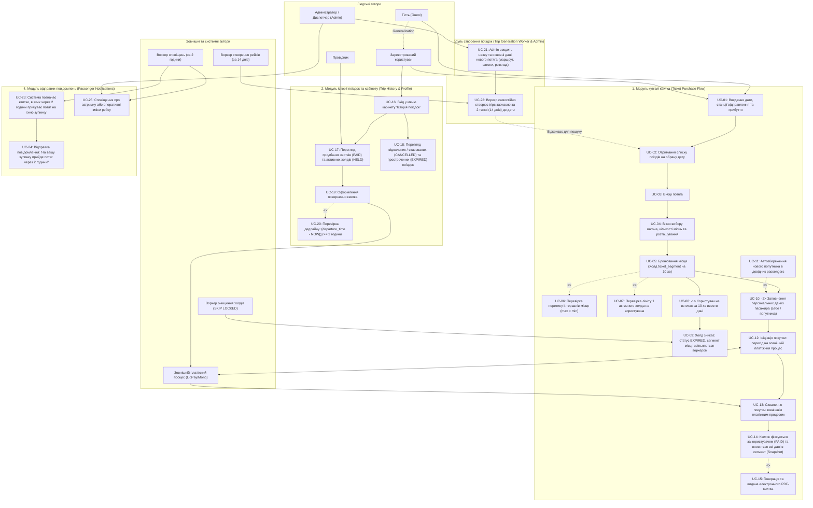
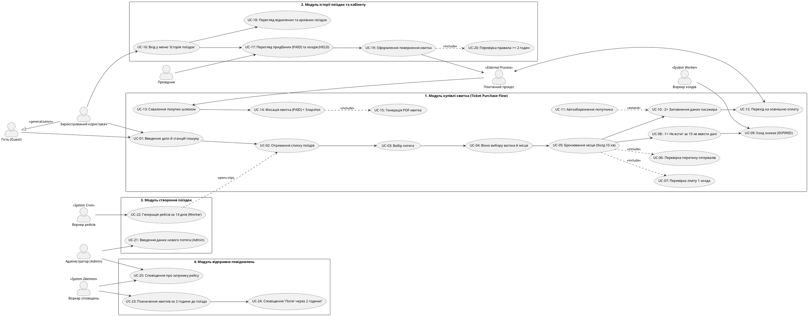

# Специфікація вимог програмного забезпечення (Software Requirements Specification) — EasyRail Core

**Дисципліна:** Бази даних та інформаційні системи  
**Тема лабораторної роботи:** Специфікація вимог (EARS), User Stories, BDD-сценарії (Gherkin), прецеденти (Use Cases) та матриця трасування ($M:N$)  
**Проєкт:** EasyRail — високонадійна система залізничного бронювання з інтервальним продажем місць  
**Версія документу:** 2.2 (Деталізований життєвий цикл покупки та розгалуження холда)  
**Статус:** Затверджено  

---

## 1. Контекст системи, Бізнес-цілі та Архітектурний поділ на модулі

### 1.1. Контекст проєкту
EasyRail — високонадійна розподілена система бронювання залізничних квитків, що відтворює бізнес-модель застосунку «Укрзалізниця». Проєкт підтримує високу інтенсивність транзакцій (High Load), забезпечує інтервальний продаж одного крісла різним пасажирам на неперетинні відрізки колії, використовує віртуальні місця (Lazy Evaluation, ADR 002) та Zero-Broker архітектуру очищення холдів через `FOR UPDATE SKIP LOCKED`.

### 1.2. Розподіл системи на 4 ключові функціональні модулі
1. **Модуль 1: Купівля квитка (Ticket Purchase Flow):** Повний наскрізний процес:
   $$\text{Введення дати й станцій} \to \text{Список поїздів} \to \text{Вибір потяга} \to \text{Вікно вибору вагона й місця} \to \text{Холд на 10 хв}$$
   з розгалуженням:
   - **Гілка -1 (Таймаут):** користувач не встигає за 10 хв ввести дані та оплатити $\to$ холд зникає (`EXPIRED`), сегмент звільняється воркером.
   - **Гілка -2 (Успіх):** введення даних пасажира $\to$ перехід на зовнішній платіжний процес $\to$ після схвалення покупки квиток фіксується за користувачем (`PAID`), а в `ticket_segment` вносяться всі незмінні дані (Snapshot).
2. **Модуль 2: Перевірка історії поїздок та кабінет (Trip History & Profile):** Меню кабінету з переглядом активних холдів (`HELD`), придбаних квитків (`PAID`), відхилених/скасованих (`CANCELLED`), прострочених (`EXPIRED`) та архівних поїздок, а також повернення квитка (якщо $\ge 2$ години до відправлення).
3. **Модуль 3: Створення нових поїздок (Trip Generation Worker & Train Admin):** Адміністратори під роллю `Admin` вводять назву та параметри нового потяга (маршрут, графік, вагони), а системний воркер самостійно створює записи `trips` завчасно за 2 тижні (14 днів) до дати для можливості раннього бронювання.
4. **Модуль 4: Відправка повідомлень (Passenger Notification Service):** Системний воркер позначає квитки, у яких через 2 години буде потяг на станції посадки, і надсилає повідомлення: «На вашу зупинку прийде потяг через 2 години!».

---

## 2. Актори системи та їхня ієрархія (Actors & Generalization)

```
                 +------------------------------------+
                 |            Гість (Guest)           |
                 +------------------------------------+
                                   ^
                                   | (Generalization)
                 +------------------------------------+
                 |  Зареєстрований користувач (User)  |
                 +------------------------------------+
```

### 2.1. Людські актори (Human Actors)
* **Гість (Guest):** Неавтентифікований користувач. Може вводити станції і дату та отримувати список рейсів і графік зупинок.
* **Зареєстрований користувач (Registered User / Passenger):** Нащадок актора `Guest` (Generalization). Автентифікований через JWT. Здійснює вибір крісла, утримує 10-хвилинний холд, заповнює дані пасажира, оплачує замовлення, має доступ до історії поїздок та повернення квитків.
* **Адміністратор розкладу (Train Admin / Dispatcher):** Працівник залізниці з роллю `Admin`. Вводить дані нових потягів, зупинок, вагонів та правила курсування.
* **Провідник (Train Conductor):** Працівник поїзної бригади, що валідує електронний квиток пасажира при посадці у вагон.

### 2.2. Зовнішні та системні актори (External & System Actors)
* **Зовнішній платіжний процес (Payment Gateway — LiqPay / Monobank):** Зовнішній сервіс еквайрингу для списання коштів та повернення (refund).
* **Воркер очищення холдів (Hold Expiration Worker):** Системний процес, що скасовує квитки (`EXPIRED`) після 10 хвилин без оплати через `FOR UPDATE SKIP LOCKED`.
* **Воркер створення нових поїздок (Trip Generation Worker):** Системний демон, що щоночі створює рейси за 14 днів наперед.
* **Воркер сповіщень (Notification Worker):** Системний сервіс, що відправляє сповіщення пасажирам за 2 години до приходу поїзда.

---

## 3. Діаграма прецедентів та процесу (Use Case & Process Diagram)

### 3.1. Діаграма в нотації Mermaid (`model.mmd`)



### 3.2. Діаграма PlantUML



---

## 4. Вимоги за синтаксисом EARS (Easy Approach to Requirements Syntax)

### 4.1. Event-Driven вимоги (`WHEN <trigger>, the system SHALL <response>`)
* **REQ-EARS-EV-01:** WHEN користувач після перегляду схеми вагона натискає «Забронювати місце», the system SHALL зафіксувати сегмент у таблиці `ticket_segment` зі статусом `HELD` та встановити таймер завершення `hold_expires_at = NOW() + INTERVAL '10 minutes'`.
* **REQ-EARS-EV-02:** WHEN зовнішній платіжний процес підтверджує схвалення оплати, the system SHALL зафіксувати квиток за користувачем зі статусом `PAID`, встановити `paid_at = NOW()`, внести в `ticket_segment` незмінний фінансовий Snapshot (`passenger_name`, `passenger_lastname`, `from_station_name`, `to_station_name`, `price`) та згенерувати PDF-квиток.
* **REQ-EARS-EV-03:** WHEN користувач купує квиток іншій особі, ПІБ якої відсутні в довіднику, the system SHALL автоматично додати особу в таблицю `passengers` із прив'язкою до `user_id`.
* **REQ-EARS-EV-04:** WHEN користувач подає запит на повернення квитка в статусі `PAID` і виконується умова `(departure_time - NOW()) >= INTERVAL '2 hours'`, the system SHALL перевести статус у `CANCELLED`, зафіксувати `cancelled_time = NOW()`, ініціювати реверс коштів у платіжний шлюз та звільнити сегмент для нових бронювань.
* **REQ-EARS-EV-05:** WHEN адміністратор (`Admin`) зберігає назву та конфігурацію нового потяга (маршрут, графік, вагони), the system SHALL записати параметри в базу даних для черги планування.
* **REQ-EARS-EV-06:** WHEN системний воркер запускається за щоденним розкладом, the system SHALL автоматично згенерувати рейси (`trips`) на дату `NOW() + INTERVAL '14 days'` для всіх активних маршрутів.
* **REQ-EARS-EV-07:** WHEN до прибуття поїзда на станцію посадки пасажира залишається рівно 2 години, the system SHALL відправити сповіщення: «На вашу зупинку прийде потяг через 2 години!».

### 4.2. State-Driven вимоги (`WHILE <state>, the system SHALL <response>`)
* **REQ-EARS-ST-01:** WHILE сегмент квитка перебуває у статусі `HELD` і `NOW() < hold_expires_at`, the system SHALL блокувати вибір цього фізичного крісла для будь-яких бронювань із перетином $\max(A_{\text{from}}, B_{\text{from}}) < \min(A_{\text{to}}, B_{\text{to}})$.
* **REQ-EARS-ST-02:** WHILE користувач має активний квиток зі статусом `HELD` та невичерпаним таймером 10 хв, the system SHALL блокувати спроби створення нових бронювань цим користувачем.
* **REQ-EARS-ST-03:** WHILE користувач перебуває в меню «Історія поїздок», the system SHALL показувати окремими секціями придбані квитки (`PAID`), активні холд-сесії (`HELD`), а також скасовані (`CANCELLED`) та прострочені (`EXPIRED`) поїздки.

### 4.3. Unwanted Behavior вимоги (`IF <condition>, THEN the system SHALL <response>`)
* **REQ-EARS-UW-01:** IF користувач не встигає за 10 хвилин заповнити дані та оплатити квиток (`hold_expires_at <= NOW()`), THEN фоновий воркер через `FOR UPDATE SKIP LOCKED` SHALL зняти холд: перевести статус у `EXPIRED` та звільнити місце.
* **REQ-EARS-UW-02:** IF користувач намагається обрати місце з перетином діапазону зупинок, THEN the system SHALL повернути HTTP `409 Conflict` (`ERR_SEAT_ALREADY_RESERVED`).
* **REQ-EARS-UW-03:** IF користувач із наявним активним холдом пробує створити другий, THEN the system SHALL повернути HTTP `422 Unprocessable Entity` (`ERR_USER_ACTIVE_HOLD_LIMIT_EXCEEDED`).
* **REQ-EARS-UW-04:** IF запит на повернення квитка надходить, коли `(departure_time - NOW()) < INTERVAL '2 hours'`, THEN the system SHALL відхилити операцію з HTTP `403 Forbidden` (`ERR_REFUND_DEADLINE_EXPIRED`).
* **REQ-EARS-UW-05:** IF під час щоденної генерації рейс на цільову дату вже існує в таблиці `trips`, THEN воркер SHALL пропустити його без створення дубліката.

### 4.4. Optional Feature вимоги (`WHERE <feature is included>, the system SHALL <response>`)
* **REQ-EARS-OP-01:** WHERE у пошуку увімкнено прапорець «Показати розпродані», the system SHALL відображати поїзди без вільних місць із міткою `SOLD_OUT`.
* **REQ-EARS-OP-02:** WHERE рейс затримується (`trips.delay_minutes > 0`), the system SHALL відображати скоригований час відправлення та надсилати оперативні сповіщення пасажирам.

### 4.5. Ubiquitous вимоги (`The system SHALL <response>`)
* **REQ-EARS-UB-01:** The system SHALL зберігати всі ціни та фінансові суми виключно у формі цілих чисел (`int`) у копійках ($100\text{ грн} = 10000$).
* **REQ-EARS-UB-02:** The system SHALL зберігати всі часові мітки виключно у форматі UTC із типом даних `timestamptz`.
* **REQ-EARS-UB-03:** The system SHALL дозволяти паралельне бронювання одного крісла на неперетинні суміжні відрізки (наприклад, $[1, 3)$ та $[3, 5)$).
* **REQ-EARS-UB-04:** The system SHALL застосовувати Soft Delete без фізичного видалення рядків із бази даних.
* **REQ-EARS-UB-05:** The system SHALL використовувати для всіх сурогатних ключів ідентифікатори стандарту `UUIDv7`.

### 4.6. Uncovered Requirement (Навмисно непокрита вимога — Post-v1 Scope)
* **REQ-EARS-UNC-01 (Фіскалізація чека через ПРРО):** WHERE здійснено успішну оплату, the system SHALL надсилати електронний чек у Державну податкову службу (ПРРО) та зберігати фіскальний номер.  
  *(Статус: ❌ НЕ ПОКРИТО В v1 / OUT-OF-SCOPE. Архітектурне обґрунтування: Синхронний виклик державного шлюзу при пікових навантаженнях загрожує зависанням пулу з'єднань БД; перенесено в Post-v1 Backlog як асинхронний Outbox-сервіс).*

---

## 5. User Stories та критерії прийняття (Acceptance Criteria / DoD)

### US-01: Покрокова купівля квитка з розгалуженням холда (Модуль 1)
* **As a** Зареєстрований користувач,
* **I want to** пройти покроковий сценарій купівлі квитка від пошуку до отримання PDF,
* **So that** гарантовано зарезервувати крісло на 10 хвилин, внести дані та оплатити його.
* **Acceptance Criteria (DoD):**
  1. Користувач вводить дату та станції відправлення/прибуття і бачить перелік поїздів.
  2. Після вибору потяга відкривається вікно схеми вагона для вибору крісла.
  3. Натискання «Забронювати» створює запис у `ticket_segment` зі статусом `HELD` на 10 хвилин.
  4. Якщо за 10 хвилин дані не введені або платіж не пройшов, воркер переводить квиток у `EXPIRED` і звільняє місце.
  5. Якщо користувач встигає заповнити дані та оплатити через платіжний процес, квиток фіксується зі статусом `PAID`, у сегмент записується незмінний Snapshot (ПІБ, станції, ціна в копійках) і видається PDF.

### US-02: Перевірка історії поїздок у меню кабінету (Модуль 2)
* **As a** Зареєстрований користувач,
* **I want to** зайти в меню кабінету «Історія поїздок»,
* **So that** бачити придбані квитки, активні холд-сесії, скасовані та архівні поїздки, а також повернути квиток за потреби.
* **Acceptance Criteria (DoD):**
  1. Інтерфейс виводить активні броні (`HELD`), дійсні квитки (`PAID`), скасовані (`CANCELLED`) та прострочені (`EXPIRED`) квитки.
  2. Для квитків `PAID` доступна кнопка повернення.
  3. Якщо до відправлення $\ge 2$ години, квиток скасовується зі статусом `CANCELLED`, фіксується час скасування, платіж реверсується, а місце повертається у продаж.
  4. Якщо до відправлення менше 2 годин, операція повернення блокується з HTTP `403`.

### US-03: Введення даних потяга та створення рейсів воркером за 2 тижні (Модуль 3)
* **As a** Адміністратор (Admin),
* **I want to** ввести назву та параметри нового потяга, щоб системний воркер щоденно створював рейси за 14 днів наперед,
* **So that** пасажири могли завчасно шукати поїзди та бронювати місця.
* **Acceptance Criteria (DoD):**
  1. Адміністратор зберігає дані нового потяга в таблицях `routes`, `stops`, `carriages`.
  2. Щоночі системний воркер визначає дату `TODAY + 14 days` і створює записи `trips`.
  3. Згенеровані рейси стають доступними для користувацького пошуку.

### US-04: Сповіщення пасажирів за 2 години до прибуття поїзда (Модуль 4)
* **As a** Пасажир з оплаченим квитком,
* **I want to** отримати повідомлення рівно за 2 години до приходу поїзда на мою станцію,
* **So that** вчасно вийти на посадку та знати свій вагон і місце.
* **Acceptance Criteria (DoD):**
  1. Системний воркер відстежує квитки в статусі `PAID`.
  2. За 2 години до відправлення зі станції посадки пасажиру відправляється повідомлення: «На вашу зупинку прийде потяг через 2 години!».
  3. Квиток позначається як сповіщений.
  4. Для скасованих або прострочених квитків сповіщення блокуються.

---

## 6. BDD-сценарії тестування (Gherkin: Given / When / Then / And / But)

```gherkin
Feature: Повний цикл купівлі квитка, історії поїздок, генерації рейсів та сповіщень EasyRail
  Як система залізничного бронювання
  Я хочу забезпечити покроковий флоу купівлі з розгалуженням холда, прозорий кабінет, завчасне планування та нагадування
  Щоб унеможливити конфлікти місць і гарантувати надійний сервіс

  Background:
    Given у системі активовано маршрут №705 "Київ — Львів" із зупинками:
      | station_name      | stop_order |
      | Київ-Пасажирський | 1          |
      | Коростень         | 2          |
      | Шепетівка         | 3          |
      | Львів             | 4          |
    And у потязі присутній купейний вагон №2 із місцем №14

  # ==========================================
  # МОДУЛЬ 1: КУПІВЛЯ КВИТКА (TICKET PURCHASE)
  # ==========================================

  Scenario: Покроковий успішний флоу купівлі квитка користувачем (Гілка -2)
    Given користувач "petro@example.com" є автентифікованим у системі
    And користувач не має жодного активного бронювання
    When користувач вводить дату "2026-11-01", місце відправки "Київ-Пасажирський" та прибуття "Шепетівка"
    Then він отримує список усіх поїздів на цю дату
    When він обирає потяг №705
    Then його перетягує на вікно для вибору вагона та місця
    When він після вибору кількості місць та розташування обирає місце №14 у вагоні №2
    Then у системі створюється запис "ticket_segment" зі статусом "HELD" на 10 хвилин
    And встановлюється час завершення броні "hold_expires_at = NOW() + 10 min"
    When користувач заповнює дані пасажира "Ірина Петренко" (Гілка -2)
    And ініціює покупку, де його переносить на зовнішній процес для покупки "LiqPay"
    And платіжний процес підтверджує схвалення покупки
    Then квиток фіксується за користувачем зі статусом "PAID"
    And в сегмент квитка вводяться всі дані незмінного зліпка:
      | field              | value             |
      | passenger_name     | Ірина             |
      | passenger_lastname | Петренко          |
      | from_station_name  | Київ-Пасажирський |
      | to_station_name    | Шепетівка         |
      | price              | 38000             |
    And генерується електронний PDF-квиток
    But квиток не видається, якщо зовнішній процес покупки відхилив платіж

  Scenario: Скасування холда при закінченні 10 хвилин без введення даних (Гілка -1)
    Given користувач обрав місце №14 і зафіксував сегмент зі статусом "HELD" о "12:00:00 UTC"
    And час завершення холда встановлено як "12:10:00 UTC"
    When користувач не встигає за цей час ввести дані та оплатити квиток (Гілка -1)
    And системний час досягає "12:10:01 UTC"
    And фоновий воркер виконує запит із "SKIP LOCKED"
    Then холд зникає: статус квитка змінюється на "EXPIRED"
    And сегмент місця №14 миттєво звільняється для пошуку іншими пасажирами
    But запис про прострочений холд зберігається в базі даних для аудиту без фізичного видалення

  Scenario: Захист від овербукінгу при спробі зайняти перетинний відрізок
    Given місце №14 у вагоні №2 вже заброньовано на відрізок від 1 до 3
    When інший користувач намагається обрати місце №14 на перегін від "Коростень" (2) до "Львів" (4)
    Then система розраховує перетин інтервалів: max(1, 2) < min(3, 4) => 2 < 3
    And блокує бронювання з кодом HTTP 409 Conflict
    But вибір цього ж місця на неперетинний суміжний відрізок від "Шепетівка" (3) до "Львів" (4) дозволяється успішно

  Scenario: Блокування другого активного холда для одного користувача
    Given користувач "oksana@example.com" вже утримує одне місце у статусі "HELD"
    When вона намагається забронювати друге крісло у будь-якому поїзді
    Then система відхиляє запит із HTTP 422 Unprocessable Entity
    And виводить повідомлення "ERR_USER_ACTIVE_HOLD_LIMIT_EXCEEDED"
    But новий холд стає доступним одразу після оплати або скасування поточного

  # =======================================================
  # МОДУЛЬ 2: ІСТОРІЯ ПОЇЗДОК ТА КАБІНЕТ (TRIP HISTORY)
  # =======================================================

  Scenario: Перегляд історії поїздок та оформлення повернення за дедлайном >= 2 год
    Given користувач переходить у меню кабінету "Історія поїздок"
    Then він бачить придбані квитки "PAID", активні холд-сесії "HELD" та скасовані "CANCELLED"
    When користувач натискає "Повернути квиток" на поїзд, до відправлення якого залишилося 4 години
    Then система перевіряє умову: 4 години >= 2 години (TRUE)
    And переводить квиток у статус "CANCELLED" із фіксацією часу скасування
    And ініціює повернення коштів через платіжний процес
    But якщо до відправлення залишається менше 2 годин, операція повернення блокується з HTTP 403 Forbidden

  # ===========================================================
  # МОДУЛЬ 3: СТВОРЕННЯ РЕЙСІВ ЗА 2 ТИЖНІ (TRIP WORKER & ADMIN)
  # ===========================================================

  Scenario: Створення потяга адміном та автогенерація рейсів воркером за 14 днів
    Given користувач під роллю "Admin" вводить назву та основні дані нового потяга
    And налаштовує графік зупинок і склад вагонів
    When системний воркер щоночі запускає процес генерації
    Then система самостійно створює рейс у таблиці "trips" завчасно за 2 тижні (14 днів) до дати курсування
    And люди отримують можливість знаходити поїзд та починати бронювати місця
    But воркер не створює дублікатів, якщо рейс на цільову дату вже існує

  # ===============================================================
  # МОДУЛЬ 4: СПОВІЩЕННЯ ПАСАЖИРІВ ЗА 2 ГОДИНИ (NOTIFICATIONS)
  # ===============================================================

  Scenario: Відправка сповіщення пасажиру за 2 години до прибуття поїзда на станцію
    Given пасажир має дійсний квиток зі статусом "PAID" на поїзд зі станцією посадки "Коростень"
    When системний таймер фіксує, що до прибуття поїзда на станцію "Коростень" залишається 2 години
    And система позначає цей квиток для відправки сповіщення
    Then пасажиру відправляється повідомлення: "На вашу зупинку прийде потяг через 2 години!"
    And вказуються номер потяга, вагон та місце
    But сповіщення не відправляється для квитків у статусі "CANCELLED" або "EXPIRED"
```

---

## 7. Матриця трасування (Traceability Matrix: Requirements ↔ Use Cases Grid)

Нижче наведено оновлену двовимірну матрицю, що відображає покриття кожної EARS-вимоги прецедентами ядра системи (`UC-01` .. `UC-25`). Спільні точки перетину вимоги та прецеденту позначені позначкою **`X`**.

| Requirement ID / Вимога | UC01..04 (Пошук/Місце) | UC05 (Холд 10хв) | UC06..07 (Перевірки) | UC08..09 (Гілка -1 Таймаут) | UC10..11 (Пасажир) | UC12..13 (Оплата) | UC14..15 (Snapshot/PDF) | UC16..18 (Кабінет) | UC19..20 (Повернення $\ge 2$г) | UC21..22 (Поїзд/14 днів) | UC23..24 (Сповіщ. 2 год) | UC25 (Затримка) |
| :--- | :---: | :---: | :---: | :---: | :---: | :---: | :---: | :---: | :---: | :---: | :---: | :---: |
| **REQ-EARS-EV-01** (Холд 10 хв) | X | X | X | | | | | X | | | | |
| **REQ-EARS-EV-02** (Оплата + Snapshot + PDF) | | | | | | X | X | X | | | | |
| **REQ-EARS-EV-03** (Збереження попутника) | | | | | X | X | | | | | | |
| **REQ-EARS-EV-04** (Повернення $\ge 2$ год) | | | | | | | | X | X | | | |
| **REQ-EARS-EV-05** (Введення потяга Admin) | | | | | | | | | | X | | |
| **REQ-EARS-EV-06** (Генерація trips за 14 днів)| X | | | | | | | | | X | | |
| **REQ-EARS-EV-07** (Сповіщення за 2 год) | | | | | | | | | | | X | |
| **REQ-EARS-ST-01** (Блокування місця при холді)| X | X | X | | | | | | | | | |
| **REQ-EARS-ST-02** (Ліміт 1 активного холда) | | X | X | | | | | X | | | | |
| **REQ-EARS-ST-03** (Історія поїздок у кабінеті) | | | | | | | | X | | | | |
| **REQ-EARS-UW-01** (Зникнення холда при таймауті)| | X | | X | | | | X | | | | |
| **REQ-EARS-UW-02** (Помилка овербукінгу 409) | X | X | X | | | | | | | | | |
| **REQ-EARS-UW-03** (Перевищення ліміту холдів 422)| | X | X | | | | | | | | | |
| **REQ-EARS-UW-04** (Відмова повернення < 2 год) | | | | | | | | | X | | | |
| **REQ-EARS-UW-05** (Пропуск дублікатів рейсів) | | | | | | | | | | X | | |
| **REQ-EARS-OP-01** (Показ Sold Out рейсів) | X | | | | | | | | | | | |
| **REQ-EARS-OP-02** (Затримка trips.delay_minutes)| X | | | | | | | | | | | X |
| **REQ-EARS-UB-01** (Фінанси в копійках INT) | X | X | | | | X | X | X | X | X | | |
| **REQ-EARS-UB-02** (Часові мітки в UTC timestamptz)| X | X | | X | | X | X | X | X | X | X | X |
| **REQ-EARS-UB-03** (Неконфліктність [1,3) та [3,5))| X | X | X | | | | | | | | | |
| **REQ-EARS-UB-04** (Soft Delete без видалення) | | | | X | | | | X | X | | | |
| **REQ-EARS-UB-05** (Сурогатні ключі UUIDv7) | X | X | X | X | X | X | X | X | X | X | X | X |
| **REQ-EARS-UNC-01** (Фіскалізація через ПРРО) | | | | | | | | | | | | **[OUT]** |

> **Позначення:**  
> - **`X`** — вимога закривається зазначеним пулом прецедентів;  
> - **`[OUT]`** — навмисно непокрита вимога ядра v1 (Out of Scope, перенесено в Post-v1 Backlog з архітектурним обґрунтуванням).

---

## 8. Аудит вимог, прецедентів та узгодженості з моделлю даних (Завдання 1)

### 8.1. Аудит однозначності EARS
Усі вимоги специфіковано виключно через вимірювані числові константи:
- Тайм-аут холда: рівно 10 хвилин (600 секунд);
- Дедлайн повернення: строго $\ge 2$ години (120 хвилин) до відправлення зі станції посадки;
- Горизонт планування нових рейсів: завчасно за 14 днів (2 тижні);
- Час сповіщення пасажирів: рівно за 2 години до прибуття поїзда на станцію посадки;
- Фінанси: цілочисельний тип `int` у копійках ($1\text{ грн} = 100\text{ коп}$);
- Статус-коди API: чітко закріплені (200, 201, 400, 403, 409, 422).

### 8.2. Аудит відношень `<<include>>` та `<<extend>>`
* **`<<include>>`:** Бронювання (`UC-05`) обов'язково включає перевірку інтервалів (`UC-06`) та ліміту холдів (`UC-07`); фіналізація покупки (`UC-14`) обов'язково включає створення PDF (`UC-15`); повернення (`UC-19`) обов'язково включає перевірку дедлайну 2 годин (`UC-20`).
* **`<<extend>>`:** Автозбереження попутника (`UC-11`) розширює введення пасажира (`UC-10`) лише у випадку введення нового імені особи, відсутньої в довіднику.

### 8.3. Звірка з ER-моделлю Завдання 1 (`docs/model.mmd`)
Усі сутності строго відповідають початковій базі даних:
1. `routes`, `stops`, `carriages`, `carriage_type` — конфігурація потяга Admin'ом у Модулі 3;
2. `trips` — генерація рейсів за 14 днів у Модулі 3 та фіксація затримок для сповіщень у Модулі 4;
3. `seat_templates` — основа для Lazy Evaluation у Модулі 1;
4. `ticket_segment` — ключова сутність життєвого циклу квитка (статуси `HELD`, `PAID`, `CANCELLED`, `EXPIRED`, часові мітки `hold_expires_at`, `paid_at`, `cancelled_time` та Snapshot-поля `passenger_name`, `passenger_lastname`, `from_station_name`, `to_station_name`, `price`);
5. `users`, `passengers` — автентифікація, ліміт 1 холда та довідник попутників.

### 8.4. Топ-3 розбіжності (spec ↔ артефакт)
1. **Розбіжність 1 (Розгалуження життєвого циклу холда):** У первинних схемах холд розглядався лінійно. У фінальній моделі явно відображено дві взаємовиключні гілки: таймаут без оплати (холд зникає воркером через `EXPIRED`) проти успішного заповнення даних, переходу на платіжний процес і схвалення оплати з фіксацією Snapshot.
2. **Розбіжність 2 (Горизонт планування нових рейсів):** Замість статичного розкладу введено сутність `trips` із автоматичною фоновою генерацією на 14 днів уперед воркером створення рейсів.
3. **Розбіжність 3 (Двоетапний контроль правила 2 годин):** Введено суворе правило 2 годин як для блокування повернення коштів ($< 2$ год), так і для спрацьовування воркера надсилання завчасного сповіщення пасажиру («На вашу зупинку прийде потяг через 2 години!»).
