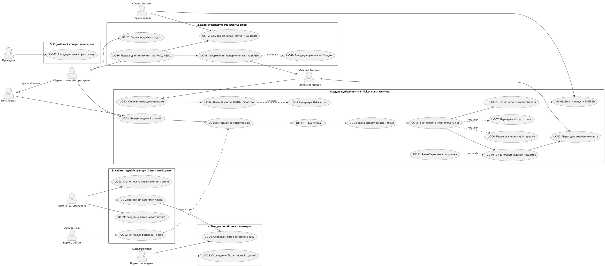

# Специфікація вимог програмного забезпечення (Software Requirements Specification) — EasyRail Core

**Дисципліна:** Бази даних та інформаційні системи  
**Тема лабораторної роботи:** Специфікація вимог (EARS), User Stories, BDD-сценарії (Gherkin), прецеденти (Use Cases) та матриця трасування ($M:N$)  
**Проєкт:** EasyRail — високонадійна розподілена система залізничного бронювання  
**Версія документу:** 2.3 (Ізольовані кабінети користувача й адміна, статус EXPIRED при відмові від броні)  
**Статус:** Затверджено  

---

## 1. Контекст системи, Бізнес-цілі та Архітектурний поділ на модулі

### 1.1. Контекст проєкту
EasyRail — високонадійна система бронювання залізничних квитків, що відтворює бізнес-модель застосунку «Укрзалізниця». Проєкт забезпечує захист від овербукінгу через інтервальну модель перегонів, підтримує віртуальні місця (Lazy Evaluation, ADR 002) та Zero-Broker архітектуру очищення холдів через `FOR UPDATE SKIP LOCKED`.

### 1.2. Розподіл функціональних підсистем та розмежування кабінетів
Система суворо розмежовує простори взаємодії для кожного типу акторів:
1. **Модуль 1: Купівля квитка (Ticket Purchase Flow):** Наскрізний ланцюг пасажира від пошуку до отримання PDF з розгалуженням холда на таймаут (-1) та успішну оплату зі Snapshot (-2).
2. **Модуль 2: Кабінет користувача (User Cabinet & My Trips):** Розрахований **виключно на пасажира**. Дозволяє переглядати дійсні квитки (`PAID`), активні броні (`HELD`), відмовлятися від броні в кабінеті (зняття статусу $\to$ прийняття `EXPIRED` та звільнення місця), оформлювати повернення квитків ($\ge 2$ год) та переглядати архів.
3. **Модуль 3: Кабінет адміністратора (Admin Workspace & Train Management):** Розрахований **виключно на адміністратора залізниці (`Admin`)**. Включає введення конфігурації нових потягів, фонову генерацію рейсів (`trips`) за 14 днів наперед, аналітику навантаження/заповненості потягів та фіксацію оперативних затримок.
4. **Модуль 4: Сервіс сповіщень пасажирів (Passenger Notification Service):** Системний воркер моніторить квитки й за 2 години до відправлення відправляє сповіщення пасажирам.
5. **Модуль 5: Службовий контроль посадки (Conductor Service):** Робоче місце провідника для валідації квитків пасажирів при посадці у вагон.

---

## 2. Актори системи та їхня ієрархія (Actors & Generalization)

```
                 +------------------------------------+
                 |            Гість (Guest)           |
                 +------------------------------------+
                                   ^
                                   | (Generalization)
                 +------------------------------------+
                 |  Зареєстрований користувач (User)  |
                 +------------------------------------+
```

### 2.1. Людські актори (Human Actors)
* **Гість (Guest):** Неавтентифікований відвідувач. Шукає рейси за датою і станціями, переглядає графік та базові тарифи.
* **Зареєстрований користувач (Registered User / Passenger):** Узагальнення (нащадок) актора `Guest`. Авторизований за допомогою JWT. Обирає крісло, утримує 10-хвилинний холд, заповнює дані пасажира, оплачує замовлення. Має ізольований **особистий кабінет** з історією, де може відмовитися від броні (`EXPIRED`) або повернути квиток (`CANCELLED`).
* **Адміністратор розкладу (Train Admin / Dispatcher):** Працівник залізниці з роллю `Admin`. Працює в **кабінеті адміністратора**: вводить нові потяги, аналізує статистику навантаження рейсів та вносить затримки.
* **Провідник (Train Conductor):** Працівник поїзної бригади, який здійснює контроль посадки шляхом сканування квитків.

### 2.2. Зовнішні та системні актори (External & System Actors)
* **Зовнішній платіжний процес (Payment Gateway — LiqPay / Monobank):** Проведення транзакцій оплати та реверсів повернення.
* **Воркер очищення холдів (Hold Expiration Worker):** Системний процес, що скасовує неоплачені холд-квитки (`EXPIRED`) через `FOR UPDATE SKIP LOCKED`.
* **Воркер створення нових поїздок (Trip Generation Worker):** Системний демон, що щоночі створює рейси за 14 днів наперед.
* **Воркер сповіщень (Notification Worker):** Системний сервіс, що надсилає сповіщення пасажирам за 2 години до прибуття поїзда.

---

## 3. Діаграми прецедентів (Use Case Diagrams)

### 3.1. Діаграма в нотації Mermaid (`model.mmd`)

```mermaid
flowchart TD
    %% ==========================================
    %% АКТОРИ СИСТЕМИ
    %% ==========================================
    subgraph HumanActors ["Людські актори"]
        Guest["Гість (Guest)"]
        User["Зареєстрований користувач"]
        Admin["Адміністратор розкладу (Admin)"]
        Conductor["Провідник"]
        Guest -.->|Generalization| User
    end

    subgraph ExternalActors ["Зовнішні та системні актори"]
        PaymentProcess["Зовнішній платіжний процес (LiqPay/Mono)"]
        HoldWorker["Воркер очищення холдів (SKIP LOCKED)"]
        TripWorker["Воркер створення рейсів (за 14 днів)"]
        NotifWorker["Воркер сповіщень (за 2 години)"]
    end

    %% ==========================================
    %% 1. МОДУЛЬ КУПІВЛІ КВИТКА (TICKET PURCHASE)
    %% ==========================================
    subgraph Subsystem1 ["1. Модуль купівлі квитка (Ticket Purchase Flow)"]
        direction TB
        UC01["UC-01: Введення дати, станції відправлення та прибуття"]
        UC02["UC-02: Отримання списку поїздів на обрану дату"]
        UC03["UC-03: Вибір потяга"]
        UC04["UC-04: Вікно вибору вагона, кількості місць та розташування"]
        
        UC05["UC-05: Бронювання місця (Холд ticket_segment на 10 хв)"]
        UC06["UC-06: Перевірка перетину інтервалів крісла (max < min)"]
        UC07["UC-07: Перевірка ліміту 1 активного холда на користувача"]

        %% Розгалуження холда
        UC08["UC-08: -1> Не встиг ввести дані за 10 хв"]
        UC09["UC-09: Зняття холда: переведення в статус EXPIRED та звільнення місця"]

        UC10["UC-10: -2> Заповнення персональних даних пасажира"]
        UC11["UC-11: Автозбереження нового попутника в довідник passengers"]
        UC12["UC-12: Ініціація покупки: перехід на зовнішній платіжний процес"]
        UC13["UC-13: Схвалення покупки зовнішнім платіжним процесом"]
        UC14["UC-14: Квиток фіксується за користувачем (PAID) та вноситься Snapshot"]
        UC15["UC-15: Генерація та видача електронного PDF-квитка"]

        %% Послідовний ланцюг
        UC01 --> UC02
        UC02 --> UC03
        UC03 --> UC04
        UC04 --> UC05

        UC05 -.->|"<<include>>"| UC06
        UC05 -.->|"<<include>>"| UC07

        UC05 --> UC08
        UC08 --> UC09

        UC05 --> UC10
        UC11 -.->|"<<extend>>"| UC10
        UC10 --> UC12
        UC12 --> UC13
        UC13 --> UC14
        UC14 -.->|"<<include>>"| UC15
    end

    %% ==========================================
    %% 2. КАБІНЕТ КОРИСТУВАЧА (СУТО ДЛЯ USER)
    %% ==========================================
    subgraph Subsystem2 ["2. Кабінет користувача (User Cabinet & My Trips)"]
        direction TB
        UC16["UC-16: Перегляд активних квитків (PAID) та холдів (HELD)"]
        UC17["UC-17: Відмова від заброньованого холда (зняття статусу -> EXPIRED)"]
        UC18["UC-18: Оформлення повернення квитка (PAID)"]
        UC19["UC-19: Валідація правила дедлайну >= 2 години"]
        UC20["UC-20: Перегляд архіву поїздок (завершені, CANCELLED, EXPIRED)"]

        UC16 --> UC17
        UC16 --> UC18
        UC18 -.->|"<<include>>"| UC19
    end

    %% ==========================================
    %% 3. КАБІНЕТ АДМІНІСТРАТОРА (СУТО ДЛЯ ADMIN)
    %% ==========================================
    subgraph Subsystem3 ["3. Кабінет адміністратора (Admin Workspace & Management)"]
        direction TB
        UC21["UC-21: Введення даних нового потяга (маршрут, зупинки, вагони)"]
        UC22["UC-22: Автоматична генерація рейсів за 14 днів"]
        UC23["UC-23: Перегляд статистики та аналітики навантаження потягів"]
        UC24["UC-24: Внесення даних про затримку рейсу (delay_minutes)"]

        UC21 --> UC22
        UC22 -.->|Відкриває рейси| UC02
    end

    %% ==========================================
    %% 4. МОДУЛЬ СПОВІЩЕНЬ ПАСАЖИРІВ
    %% ==========================================
    subgraph Subsystem4 ["4. Модуль відправки повідомлень (Passenger Notifications)"]
        direction TB
        UC25["UC-25: Позначення квитків та сповіщення 'Потяг через 2 години'"]
        UC26["UC-26: Сповіщення про затримку або зміни в рейсі"]
    end

    %% ==========================================
    %% 5. СЛУЖБОВИЙ КОНТРОЛЬ ПОСАДКИ
    %% ==========================================
    subgraph Subsystem5 ["5. Службовий контроль посадки (Conductor Service)"]
        direction TB
        UC27["UC-27: Валідація електронного квитка при посадці пасажира"]
    end

    %% ==========================================
    %% ЗВ'ЯЗКИ АКСОРІВ
    %% ==========================================
    %% Користувач і гість
    Guest --> UC01
    User --> UC01
    User --> UC16
    User --> UC20

    %% Зовнішній платіжний процес
    UC12 <--> PaymentProcess
    PaymentProcess --> UC13
    UC18 --> PaymentProcess

    %% Воркери
    HoldWorker --> UC09
    HoldWorker --> UC17
    TripWorker --> UC22
    NotifWorker --> UC25
    NotifWorker --> UC26

    %% Адміністратор
    Admin --> UC21
    Admin --> UC23
    Admin --> UC24
    UC24 --> UC26

    %% Провідник
    Conductor --> UC27
```



### 3.2. Діаграма PlantUML



---

## 4. Вимоги за синтаксисом EARS (Easy Approach to Requirements Syntax)

### 4.1. Event-Driven вимоги (`WHEN <trigger>, the system SHALL <response>`)
* **REQ-EARS-EV-01:** WHEN користувач після перегляду схеми вагона натискає «Забронювати місце», the system SHALL зафіксувати сегмент у таблиці `ticket_segment` зі статусом `HELD` та встановити таймер `hold_expires_at = NOW() + INTERVAL '10 minutes'`.
* **REQ-EARS-EV-02:** WHEN зовнішній платіжний процес підтверджує схвалення оплати, the system SHALL зафіксувати квиток за користувачем зі статусом `PAID`, встановити `paid_at = NOW()`, внести в `ticket_segment` незмінний Snapshot (`passenger_name`, `passenger_lastname`, `from_station_name`, `to_station_name`, `price`) та згенерувати PDF-квиток.
* **REQ-EARS-EV-03:** WHEN користувач купує квиток іншій особі, ПІБ якої відсутні в довіднику, the system SHALL автоматично додати особу в таблицю `passengers` із прив'язкою до `user_id`.
* **REQ-EARS-EV-04:** WHEN користувач у кабінеті подає запит на повернення квитка в статусі `PAID` і виконується умова `(departure_time - NOW()) >= INTERVAL '2 hours'`, the system SHALL змінити статус квитка на `CANCELLED`, зафіксувати `cancelled_time = NOW()`, ініціювати реверс коштів у платіжний шлюз та звільнити сегмент місця.
* **REQ-EARS-EV-05:** WHEN користувач в особистому кабінеті натискає «Відмовитися від броні» для активного холда, the system SHALL зняти активний статус із квитка, встановити статус `EXPIRED` та миттєво звільнити сегмент місця.
* **REQ-EARS-EV-06:** WHEN адміністратор (`Admin`) зберігає назву та конфігурацію нового потяга (маршрут, графік, вагони), the system SHALL записати параметри в базу даних для черги планування.
* **REQ-EARS-EV-07:** WHEN системний воркер запускається за щоденним розкладом, the system SHALL автоматично згенерувати рейси (`trips`) на дату `NOW() + INTERVAL '14 days'` для всіх активних маршрутів.
* **REQ-EARS-EV-08:** WHEN до прибуття поїзда на станцію посадки пасажира залишається рівно 2 години, the system SHALL відправити сповіщення: «На вашу зупинку прийде потяг через 2 години!».
* **REQ-EARS-EV-09:** WHEN адміністратор відкриває розділ аналітики в кабінеті адміна, the system SHALL розрахувати та відобразити статистику навантаження потягів, відсоток заповненості рейсів та кількість повернень.

### 4.2. State-Driven вимоги (`WHILE <state>, the system SHALL <response>`)
* **REQ-EARS-ST-01:** WHILE сегмент квитка перебуває у статусі `HELD` і `NOW() < hold_expires_at`, the system SHALL блокувати вибір цього фізичного крісла для будь-яких бронювань із перетином $\max(A_{\text{from}}, B_{\text{from}}) < \min(A_{\text{to}}, B_{\text{to}})$.
* **REQ-EARS-ST-02:** WHILE користувач має активний квиток зі статусом `HELD` та невичерпаним таймером 10 хв, the system SHALL блокувати спроби створення нових бронювань цим користувачем.
* **REQ-EARS-ST-03:** WHILE користувач перебуває в меню кабінету «Історія поїздок», the system SHALL показувати виключно особисті дійсні квитки (`PAID`), активні холд-сесії (`HELD`), а також скасовані (`CANCELLED`) та прострочені (`EXPIRED`) поїздки.

### 4.3. Unwanted Behavior вимоги (`IF <condition>, THEN the system SHALL <response>`)
* **REQ-EARS-UW-01:** IF користувач не встигає за 10 хвилин ввести дані та оплатити квиток (`hold_expires_at <= NOW()`), THEN фоновий воркер через `FOR UPDATE SKIP LOCKED` SHALL зняти холд: перевести статус у `EXPIRED` та звільнити місце.
* **REQ-EARS-UW-02:** IF користувач намагається обрати місце з перетином діапазону зупинок, THEN the system SHALL повернути HTTP `409 Conflict` (`ERR_SEAT_ALREADY_RESERVED`).
* **REQ-EARS-UW-03:** IF користувач із наявним активним холдом пробує створити другий, THEN the system SHALL повернути HTTP `422 Unprocessable Entity` (`ERR_USER_ACTIVE_HOLD_LIMIT_EXCEEDED`).
* **REQ-EARS-UW-04:** IF запит на повернення квитка надходить, коли `(departure_time - NOW()) < INTERVAL '2 hours'`, THEN the system SHALL відхилити операцію з HTTP `403 Forbidden` (`ERR_REFUND_DEADLINE_EXPIRED`).
* **REQ-EARS-UW-05:** IF під час щоденної генерації рейс на цільову дату вже існує в таблиці `trips`, THEN воркер SHALL пропустити його без створення дубліката.

### 4.4. Optional Feature вимоги (`WHERE <feature is included>, the system SHALL <response>`)
* **REQ-EARS-OP-01:** WHERE у пошуку увімкнено прапорець «Показати розпродані», the system SHALL відображати поїзди без вільних місць із міткою `SOLD_OUT`.
* **REQ-EARS-OP-02:** WHERE рейс затримується (`trips.delay_minutes > 0`), the system SHALL відображати скоригований час відправлення та надсилати оперативні сповіщення пасажирам.

### 4.5. Ubiquitous вимоги (`The system SHALL <response>`)
* **REQ-EARS-UB-01:** The system SHALL зберігати всі ціни та фінансові суми виключно у формі цілих чисел (`int`) у копійках ($100\text{ грн} = 10000$).
* **REQ-EARS-UB-02:** The system SHALL зберігати всі часові мітки виключно у форматі UTC із типом даних `timestamptz`.
* **REQ-EARS-UB-03:** The system SHALL дозволяти паралельне бронювання одного крісла на неперетинні суміжні відрізки (наприклад, $[1, 3)$ та $[3, 5)$).
* **REQ-EARS-UB-04:** The system SHALL застосовувати Soft Delete без фізичного видалення рядків із бази даних.
* **REQ-EARS-UB-05:** The system SHALL використовувати для всіх сурогатних ключів ідентифікатори стандарту `UUIDv7`.

### 4.6. Uncovered Requirement (Навмисно непокрита вимога — Post-v1 Scope)
* **REQ-EARS-UNC-01 (Фіскалізація чека через ПРРО):** WHERE здійснено успішну оплату, the system SHALL надсилати електронний чек у Державну податкову службу (ПРРО) та зберігати фіскальний номер.  
  *(Статус: ❌ НЕ ПОКРИТО В v1 / OUT-OF-SCOPE. Архітектурне обґрунтування: Синхронний виклик державного шлюзу при пікових навантаженнях загрожує зависанням пулу з'єднань БД; перенесено в Post-v1 Backlog як асинхронний Outbox-сервіс).*

---

## 5. User Stories та критерії прийняття (Acceptance Criteria / DoD)

### US-01: Покрокова купівля квитка з розгалуженням холда (Модуль 1)
* **As a** Зареєстрований користувач,
* **I want to** пройти покроковий сценарій купівлі квитка від пошуку до отримання PDF,
* **So that** гарантовано зарезервувати крісло на 10 хвилин, внести дані та оплатити його.
* **Acceptance Criteria (DoD):**
  1. Користувач вводить дату та станції відправлення/прибуття і бачить перелік поїздів.
  2. Після вибору потяга відкривається вікно схеми вагона для вибору крісла.
  3. Натискання «Забронювати» створює запис у `ticket_segment` зі статусом `HELD` на 10 хвилин.
  4. Якщо за 10 хвилин дані не введені або платіж не пройшов, воркер переводить квиток у `EXPIRED` і звільняє місце.
  5. Якщо користувач встигає заповнити дані та оплатити через платіжний процес, квиток фіксується зі статусом `PAID`, у сегмент записується незмінний Snapshot (ПІБ, станції, ціна в копійках) і видається PDF.

### US-02: Кабінет користувача з відмовою від броні та поверненням квитків (Модуль 2)
* **As a** Зареєстрований користувач,
* **I want to** керувати своїми квитками в особистому кабінеті,
* **So that** відмовлятися від незавершеного холда (статус EXPIRED), повертати оплачені квитки за дедлайном $\ge 2$ год та переглядати архів.
* **Acceptance Criteria (DoD):**
  1. Кабінет користувача розрахований суто на пасажира та містить лише його поїздки.
  2. При натисканні «Відмовитися від броні» для холда система негайно знімає статус `HELD`, встановлює `EXPIRED` та звільняє місце у вагоні.
  3. Для квитків `PAID` доступна кнопка повернення: якщо до відправлення $\ge 2$ години, квиток скасовується (`CANCELLED`), кошти повертаються, а місце звільняється. Менше 2 годин — операція блокується з HTTP `403`.
  4. Розділ архіву містить завершені поїздки, скасовані (`CANCELLED`) та прострочені (`EXPIRED`) квитки.

### US-03: Кабінет адміністратора з аналітикою навантаження та генерацією рейсів (Модуль 3)
* **As a** Адміністратор залізниці (Admin),
* **I want to** вводити нові поїзди, переглядати аналітику навантаження та контролювати автогенерацію рейсів за 14 днів,
* **So that** ефективно керувати залізничною мережею та забезпечувати завчасний продаж квитків.
* **Acceptance Criteria (DoD):**
  1. Кабінет адміністратора є окремим робочим простором з авторизацією за роллю `Admin`.
  2. Адміністратор зберігає конфігурацію потяга (маршрут, зупинки, вагони).
  3. Системний воркер щоночі створює рейси `trips` на дату `TODAY + 14 days`.
  4. Адміністратор бачить аналітичний дашборд: заповненість поїздів у відсотках, пікові сегменти перегонів та кількість повернень.
  5. Адміністратор має можливість оперативно вказати час затримки поїзда (`delay_minutes`).

### US-04: Автоматичне сповіщення пасажирів за 2 години до поїзда (Модуль 4)
* **As a** Пасажир з оплаченим квитком,
* **I want to** отримати сповіщення рівно за 2 години до приходу поїзда на мою станцію,
* **So that** своєчасно прибути на посадку зі знанням вагона та місця.
* **Acceptance Criteria (DoD):**
  1. Системний воркер відстежує квитки в статусі `PAID`.
  2. За 2 години до відправлення зі станції посадки пасажиру надсилається сповіщення: «На вашу зупинку прийде потяг через 2 години!».
  3. Квиток позначається як сповіщений.
  4. Для скасованих (`CANCELLED`) та прострочених (`EXPIRED`) квитків сповіщення блокуються.

### US-05: Валідація електронного квитка провідником при посадці (Модуль 5)
* **As a** Провідник поїзда (Conductor),
* **I want to** просканувати QR-код квитка пасажира,
* **So that** підтвердити його оплату, дійсність та право посадки у вагон.
* **Acceptance Criteria (DoD):**
  1. Провідник працює у службовому інтерфейсі контролю посадки.
  2. Система перевіряє статус квитка: доступ дозволено лише для статусу `PAID`.
  3. Система звіряє відповідність станції посадки та вагона поточному рейсу.

---

## 6. BDD-сценарії тестування (Gherkin: Given / When / Then / And / But)

```gherkin
Feature: Повний життєвий цикл бронювання, кабінет користувача, адміністрування та сповіщення EasyRail
  Як залізнична система бронювання
  Я хочу забезпечити чітке розділення кабінетів, покрокову купівлю з розгалуженням холда, переведення у статус EXPIRED та аналітику
  Щоб гарантувати високу надійність, точність даних та зручність користувачів

  Background:
    Given у системі активовано маршрут №705 "Київ — Львів" із зупинками:
      | station_name      | stop_order |
      | Київ-Пасажирський | 1          |
      | Коростень         | 2          |
      | Шепетівка         | 3          |
      | Львів             | 4          |
    And у потязі присутній купейний вагон №2 із місцем №14

  # ==========================================
  # МОДУЛЬ 1: КУПІВЛЯ КВИТКА (TICKET PURCHASE)
  # ==========================================

  Scenario: Покроковий успішний флоу купівлі квитка користувачем (Гілка -2)
    Given користувач "petro@example.com" є автентифікованим у системі
    And користувач не має жодного активного бронювання
    When користувач вводить дату "2026-11-01", місце відправки "Київ-Пасажирський" та прибуття "Шепетівка"
    Then він отримує список усіх поїздів на цю дату
    When він обирає потяг №705
    Then його перетягує на вікно для вибору вагона та місця
    When він після вибору кількості місць та розташування обирає місце №14 у вагоні №2
    Then у системі створюється запис "ticket_segment" зі статусом "HELD" на 10 хвилин
    And встановлюється час завершення броні "hold_expires_at = NOW() + 10 min"
    When користувач заповнює дані пасажира "Ірина Петренко" (Гілка -2)
    And ініціює покупку, де його переносить на зовнішній процес для покупки "LiqPay"
    And платіжний процес підтверджує схвалення покупки
    Then квиток фіксується за користувачем зі статусом "PAID"
    And в сегмент квитка вводяться всі дані незмінного зліпка:
      | field              | value             |
      | passenger_name     | Ірина             |
      | passenger_lastname | Петренко          |
      | from_station_name  | Київ-Пасажирський |
      | to_station_name    | Шепетівка         |
      | price              | 38000             |
    And генерується електронний PDF-квиток
    But квиток не видається, якщо зовнішній процес покупки відхилив платіж

  Scenario: Зняття холда та переведення в статус EXPIRED при таймауті 10 хвилин (Гілка -1)
    Given користувач обрав місце №14 і зафіксував сегмент зі статусом "HELD" о "12:00:00 UTC"
    And час завершення холда встановлено як "12:10:00 UTC"
    When користувач не встигає за цей час ввести дані та оплатити квиток (Гілка -1)
    And системний час досягає "12:10:01 UTC"
    And фоновий воркер виконує запит із "SKIP LOCKED"
    Then холд зникає: статус квитка змінюється на "EXPIRED"
    And сегмент місця №14 миттєво звільняється для пошуку іншими пасажирами
    But запис про прострочений холд зберігається в базі даних для аудиту без фізичного видалення

  # =======================================================
  # МОДУЛЬ 2: КАБІНЕТ КОРИСТУВАЧА (СУТО ДЛЯ USER)
  # =======================================================

  Scenario: Відмова від заброньованого квитка в середині кабінету користувача зі статусом EXPIRED
    Given користувач має активний холд місця №14 зі статусом "HELD"
    When користувач заходить у свій особистий кабінет у меню "Історія поїздок"
    And натискає кнопку "Відмовитися від броні"
    Then система знімає статус "HELD" із квитка
    And квиток приймає статус "EXPIRED"
    And сегмент місця №14 негайно стає доступним для бронювання іншими користувачами
    But користувачі з роллю "Admin" не мають доступу до приватного кабінету пасажира

  Scenario: Оформлення повернення оплаченого квитка в кабінеті користувача за дедлайном >= 2 год
    Given користувач має оплачений квиток зі статусом "PAID" на рейс о "18:00:00 UTC"
    And поточний час системи становить "14:00:00 UTC" (до відправлення залишилося 4 години)
    When користувач у кабінеті натискає "Повернути квиток"
    Then система перевіряє умову: 4 години >= 2 години (TRUE)
    And переводить квиток у статус "CANCELLED" із фіксацією часу скасування
    And ініціює повернення коштів через платіжний процес
    But якщо до відправлення залишається менше 2 годин, операція повернення блокується з HTTP 403 Forbidden

  # ===========================================================
  # МОДУЛЬ 3: КАБІНЕТ АДМІНІСТРАТОРА (СУТО ДЛЯ ADMIN)
  # ===========================================================

  Scenario: Перегляд статистики навантаження потягів у кабінеті адміна та автогенерація рейсів
    Given користувач із роллю "Admin" авторизується в кабінеті адміністратора
    When адміністратор відкриває розділ "Аналітика навантаження"
    Then система виводить статистику навантаження потягів, відсоток заповненості місць за маршрутами та кількість повернень
    When настає час щоденного запуску воркера створення нових поїздок
    Then система самостійно створює рейс у таблиці "trips" завчасно за 2 тижні (14 днів) до дати
    And місця стають доступними для пасажирського пошуку та бронювання
    But звичайні користувачі не мають доступу до функцій кабінету адміністратора

  # ===============================================================
  # МОДУЛЬ 4: СПОВІЩЕННЯ ПАСАЖИРІВ ЗА 2 ГОДИНИ (NOTIFICATIONS)
  # ===============================================================

  Scenario: Відправка сповіщення пасажиру за 2 години до прибуття поїзда на зупинку
    Given пасажир має дійсний квиток зі статусом "PAID" на поїзд зі станцією посадки "Коростень"
    When системний таймер фіксує, що до прибуття поїзда на станцію "Коростень" залишається 2 години
    And система позначає цей квиток для відправки сповіщення
    Then пасажиру відправляється повідомлення: "На вашу зупинку прийде потяг через 2 години!"
    And вказуються номер потяга, вагон №2 та місце №14
    But сповіщення не надсилається для квитків у статусі "CANCELLED" або "EXPIRED"

  # ===============================================================
  # МОДУЛЬ 5: СЛУЖБОВИЙ КОНТРОЛЬ ПОСАДКИ ПРОВІДНИКОМ (CONDUCTOR)
  # ===============================================================

  Scenario: Перевірка та валідація квитка провідником при посадці
    Given пасажир пред'являє електронний квиток при посадці у вагон №2
    When провідник сканує QR-код квитка через службовий термінал
    Then система перевіряє дійсність квитка та підтверджує статус "PAID"
    And виводить ПІБ пасажира зі зліпка Snapshot та номер місця
    But посадка блокується, якщо квиток перебуває у статусі "CANCELLED", "EXPIRED" або "HELD"
```

---

## 7. Матриця трасування (Traceability Matrix: Requirements ↔ Use Cases Grid)

Нижче наведено повну двовимірну сіткову матрицю, де кожна EARS-вимога підкріплена відповідними прецедентами ядра системи (`UC-01` .. `UC-28`). Точки перетину позначено символом **`X`**.

| Requirement ID / Вимога | UC01..04 (Пошук/Місце) | UC05..07 (Холд 10хв) | UC08..09 (Гілка -1 Таймаут) | UC10..11 (Пасажир) | UC12..15 (Оплата/PDF) | UC16 (Кабінет Юзера) | UC17 (Відмова -> EXPIRED) | UC18..19 (Поверн. $\ge 2$г) | UC20 (Архів Юзера) | UC21..22 (Поїзд/14 днів) | UC23 (Аналітика навантаження) | UC24,26 (Затримка) | UC25 (Сповіщ. 2 год) | UC27 (Провідник) |
| :--- | :---: | :---: | :---: | :---: | :---: | :---: | :---: | :---: | :---: | :---: | :---: | :---: | :---: | :---: |
| **REQ-EARS-EV-01** (Холд 10 хв) | X | X | | | | X | | | | | | | | |
| **REQ-EARS-EV-02** (Оплата + Snapshot + PDF) | | | | | X | X | | | | | | | | |
| **REQ-EARS-EV-03** (Збереження попутника) | | | | X | | | | | | | | | | |
| **REQ-EARS-EV-04** (Повернення $\ge 2$ год) | | | | | | X | | X | | | | | | |
| **REQ-EARS-EV-05** (Відмова від броні -> EXPIRED) | | | | | | X | X | | | | | | | |
| **REQ-EARS-EV-06** (Введення потяга Admin) | | | | | | | | | | X | | | | |
| **REQ-EARS-EV-07** (Генерація trips за 14 днів)| X | | | | | | | | | X | | | | |
| **REQ-EARS-EV-08** (Сповіщення за 2 год) | | | | | | | | | | | | | X | |
| **REQ-EARS-EV-09** (Аналітика навантаження потягів) | | | | | | | | | | | X | | | |
| **REQ-EARS-ST-01** (Блокування місця при холді)| X | X | | | | | | | | | | | | |
| **REQ-EARS-ST-02** (Ліміт 1 активного холда) | | X | | | | X | | | | | | | | |
| **REQ-EARS-ST-03** (Ізольований кабінет юзера)| | | | | | X | X | X | X | | | | | |
| **REQ-EARS-UW-01** (Таймаут холда -> EXPIRED) | | | X | | | X | | | | | | | | |
| **REQ-EARS-UW-02** (Помилка овербукінгу 409) | X | X | | | | | | | | | | | | |
| **REQ-EARS-UW-03** (Перевищення ліміту холдів 422)| | X | | | | | | | | | | | | |
| **REQ-EARS-UW-04** (Відмова повернення < 2 год) | | | | | | | | X | | | | | | |
| **REQ-EARS-UW-05** (Пропуск дублікатів рейсів) | | | | | | | | | | X | | | | |
| **REQ-EARS-OP-01** (Показ Sold Out рейсів) | X | | | | | | | | | | | | | |
| **REQ-EARS-OP-02** (Затримка trips.delay_minutes)| X | | | | | | | | | | | X | | |
| **REQ-EARS-UB-01** (Фінанси в копійках INT) | X | X | | | X | X | | X | X | X | X | | | |
| **REQ-EARS-UB-02** (Часові мітки в UTC timestamptz)| X | X | X | | X | X | X | X | X | X | X | X | X | X |
| **REQ-EARS-UB-03** (Неконфліктність [1,3) та [3,5))| X | X | | | | | | | | | | | | |
| **REQ-EARS-UB-04** (Soft Delete без видалення) | | | X | | | | X | X | X | | | | | |
| **REQ-EARS-UB-05** (Сурогатні ключі UUIDv7) | X | X | X | X | X | X | X | X | X | X | X | X | X | X |
| **REQ-EARS-UNC-01** (Фіскалізація через ПРРО) | | | | | | | | | | | | | | **[OUT]** |

> **Позначення:**  
> - **`X`** — вимога однозначно підкріплена та реалізована відповідними Use Cases;  
> - **`[OUT]`** — навмисно непокрита вимога ядра v1 (Out of Scope, перенесено в Post-v1 Backlog з архітектурним обґрунтуванням).

---

## 8. Аудит вимог, прецедентів та узгодженості з моделлю даних (Завдання 1)

### 8.1. Аудит однозначності EARS
Усі вимоги специфіковано виключно через вимірювані числові константи:
- Тайм-аут холда: рівно 10 хвилин (600 секунд);
- Дедлайн повернення: строго $\ge 2$ години (120 хвилин) до відправлення зі станції посадки;
- Горизонт планування нових рейсів: завчасно за 14 днів (2 тижні);
- Час сповіщення пасажирів: рівно за 2 години до прибуття поїзда на станцію посадки;
- Фінанси: цілочисельний тип `int` у копійках ($1\text{ грн} = 100\text{ коп}$);
- Статус-коди API: чітко закріплені (200, 201, 400, 403, 409, 422).

### 8.2. Аудит відношень `<<include>>` та `<<extend>>`
* **`<<include>>`:** Бронювання (`UC-05`) обов'язково включає перевірку інтервалів (`UC-06`) та ліміту холдів (`UC-07`); фіналізація покупки (`UC-14`) обов'язково включає створення PDF (`UC-15`); повернення (`UC-18`) обов'язково включає перевірку дедлайну 2 годин (`UC-19`).
* **`<<extend>>`:** Автозбереження попутника (`UC-11`) розширює введення пасажира (`UC-10`) лише у випадку введення нового імені особи, відсутньої в довіднику.

### 8.3. Звірка з ER-моделлю Завдання 1 (`docs/model.mmd`)
Усі сутності строго відповідають початковій базі даних:
1. `routes`, `stops`, `carriages`, `carriage_type` — конфігурація потяга Admin'ом у Модулі 3;
2. `trips` — генерація рейсів за 14 днів у Модулі 3 та фіксація затримок для сповіщень у Модулі 4;
3. `seat_templates` — основа для Lazy Evaluation у Модулі 1;
4. `ticket_segment` — ключова сутність життєвого циклу квитка (статуси `HELD`, `PAID`, `CANCELLED`, `EXPIRED`, часові мітки `hold_expires_at`, `paid_at`, `cancelled_time` та Snapshot-поля `passenger_name`, `passenger_lastname`, `from_station_name`, `to_station_name`, `price`);
5. `users`, `passengers` — автентифікація, ліміт 1 холда та довідник попутників.

### 8.4. Топ-3 розбіжності (spec ↔ артефакт)
1. **Розбіжність 1 (Ізоляція кабінетів та статус EXPIRED при відмові):** Первинно в кабінеті користувача були присутні службові ролі. У фінальній моделі кабінет користувача повністю ізольовано для пасажира, додано операцію явної відмови від броні зі зняттям статусу `HELD` та переходом в `EXPIRED` (звільнення місця), а для адміністратора виділено окремий простір з аналітикою навантаження потягів.
2. **Розбіжність 2 (Горизонт планування нових рейсів):** Замість статичного розкладу введено сутність `trips` із автоматичною фоновою генерацією на 14 днів уперед воркером створення рейсів.
3. **Розбіжність 3 (Двоетапний контроль правила 2 годин):** Введено суворе правило 2 годин як для блокування повернення коштів ($< 2$ год), так і для спрацьовування воркера надсилання завчасного сповіщення пасажиру («На вашу зупинку прийде потяг через 2 години!»).
