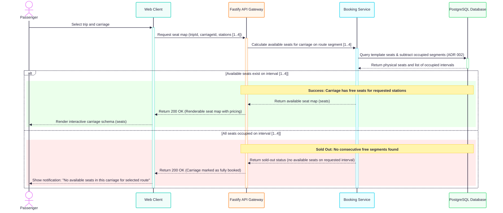
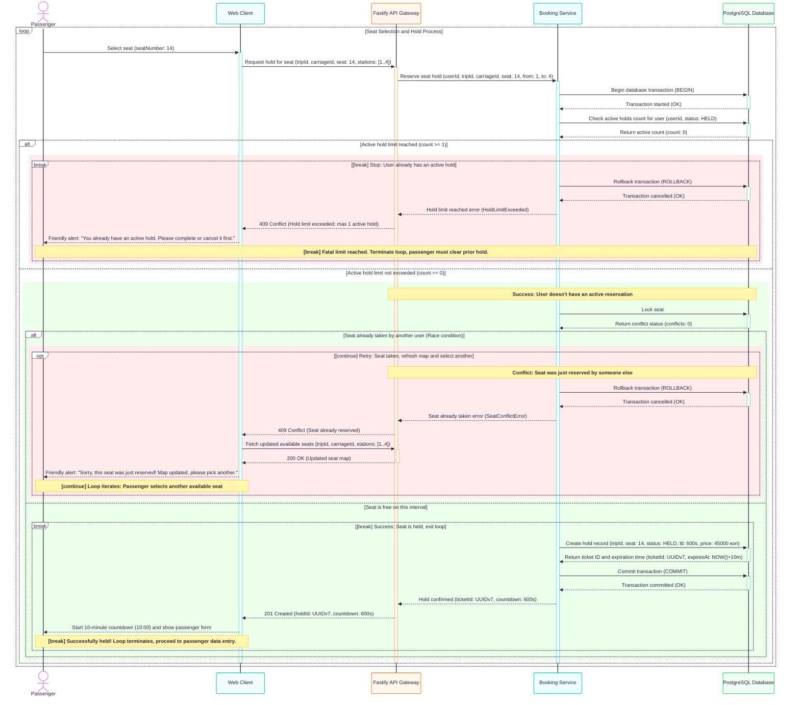
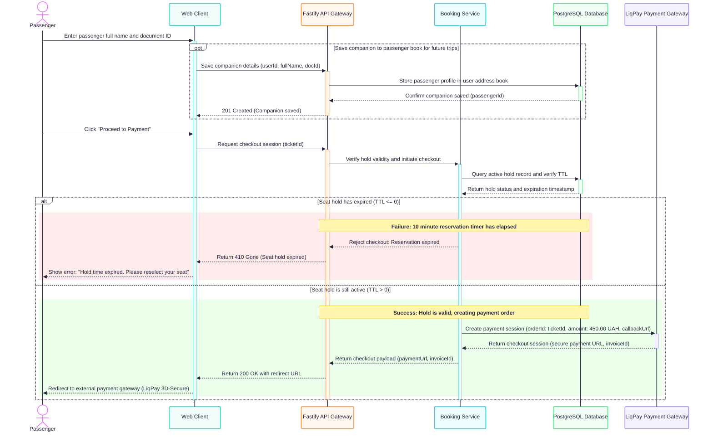
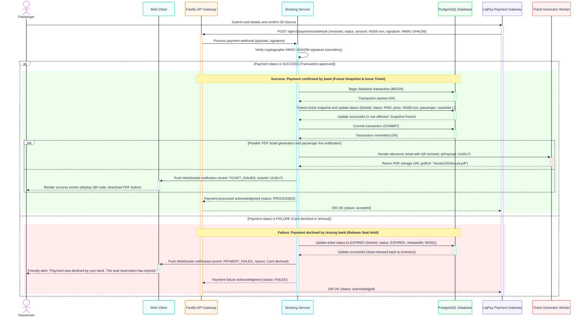

# Специфікація динаміки взаємодії: Use Case «Купівля залізничного квитка» 

---

## 1. Контекст, мета та межі аналізу

### 1.1. Обґрунтування вибору Use Case
У Завданні 2 було сформовано та декомпозовано 27 прецедентів системи EasyRail. Для детального моделювання динаміки внутрішньої взаємодії обрано центральний, найбільш критичний та транзакційно навантажений Use Case системи — **«Купівля залізничного квитка»** (об'єднує прецеденти `UC-04 .. UC-15`). 

Саме цей прецедент:
1. Задіює максимальну кількість архітектурних рішень (ADR 001..008 із Завдання 1);
2. Працює в умовах високої конкуренції за ресурси (гонка запитів за одне крісло на пересічних станціях маршруту);
3. Включає взаємодію із зовнішньою платіжною системою (LiqPay) за асинхронною моделлю Webhook;
4. Реалізує скінченну машину станів квитка (`HELD -> PAID` або `HELD -> EXPIRED`) та збереження незмінного фінансового зліпка (Snapshot Pattern).

### 1.2. Декомпозиція Use Case на 4 цільові сценарії
Відповідно до вимог Завдання 3, єдиний великий процес покупки розділено на **4 деталізовані та самодостатні сценарії**, кожен з яких покривається окремою Sequence-діаграмою з комбінованими фрагментами (`alt`, `opt`, `loop`, `break`, `par`):

1. **Сценарій 1 (`UC-04`):** Розрахунок доступності місць у вагоні на льоту (Lazy Evaluation);
2. **Сценарій 2 (`UC-05, 06, 07`):** Бронювання місця (Холд на 10 хв) із циклом повторного вибору (`loop`) та захистом від гонки запитів;
3. **Сценарій 3 (`UC-10, 11, 12, 08`):** Введення даних пасажира, автозбереження попутника (`opt`) та чекаут із перевіркою таймауту холда;
4. **Сценарій 4 (`UC-13, 14, 15, 09`):** Обробка банківського вебхука, фіксація фінансового Snapshot, видача PDF-квитка або вивільнення місця.

---

## 2. Учасники взаємодії (Participants & Lifelines)

Усі учасники на діаграмах послідовності строго відповідають фізичній архітектурі системи, сервісному шару та таблицям реляційної моделі даних (Завдання 1):

| Учасник (Lifeline ID) | Роль в архітектурі | Відповідність сутностям ERD (Завдання 1) | Опис зони відповідальності |
| :--- | :--- | :--- | :--- |
| **`P: Passenger`** | Кінцевий користувач (Актор) | `users`, `passengers` | Авторизований пасажир, який здійснює вибір місця, введення даних та оплату. |
| **`UI: Web Client`** | Фронтенд (SPA / Mobile) | — | Клієнтський інтерфейс, рендерить схему вагона, таймер зворотного відліку 10:00 та повідомлення про помилки. |
| **`API: Fastify API Gateway`** | Контролер / API Gateway | — | Точка входу: валідація DTO, аутентифікація JWT, маршрутизація та перетворення винятків у HTTP-статуси. |
| **`Svc: Booking Service`** | Сервісний шар бізнес-домену | — | Інкапсулює бізнес-правила: перевірку перетину станцій ($\max < \min$), ліміт холдів, розрахунок цін та підпис HMAC. |
| **`DB: PostgreSQL Database`** | Рівень збереження даних | `ticket_segment`, `trips`, `carriages`, `seat_templates`, `passengers` | Забезпечує ACID-транзакції, блокування `FOR UPDATE SKIP LOCKED`, збереження холдів та заморожування Snapshot. |
| **`Bank: LiqPay Payment Gateway`** | Зовнішня платіжна система | — | Захищений еквайринг (PCI DSS), проводить 3D-Secure та надсилає підписані вебхуки. |
| **`PDF: Ticket Generator Worker`** | Асинхронний мікросервіс | `ticket_segment.pdf_url` | Фоновий воркер для генерації бінарних PDF-квитків із криптографічним QR-кодом (`UUIDv7`). |

---

## 3. Сценарій 1: Запит схеми вагона та розрахунок вільних місць (`UC-04`)

### 3.1. Опис та передумови (Preconditions)
* **Прецедент:** `UC-04: Вікно вибору вагона, кількості місць та розташування`.
* **Передумови:** Пасажир обрав рейс (`tripId`), вказав станцію посадки (станція 1) та станцію висадки (станція 4).
* **Суть сценарію:** Реалізація **ADR 002 (Lazy Evaluation місць)**. Система не зберігає статичний інвентар фізичних крісел на кожен відрізок колії, а вираховує вільні місця на льоту шляхом віднімання зайнятих сегментів (`ticket_segment` у статусах `HELD` або `PAID`, для яких $\max(from_1, from_2) < \min(to_1, to_2)$) від загального шаблону вагона (`seat_templates`).

### 3.2. Покроковий перебіг взаємодії
1. Пасажир обирає конкретний вагон (`carriageId`).
2. `Web Client` надсилає запит `GET /api/v1/trips/{tripId}/carriages/{cId}/seats?from=1&to=4`.
3. `Fastify API Gateway` делегує розрахунок у `Booking Service`.
4. `Booking Service` виконує запит до `PostgreSQL`: вибірка фізичних номерів із `seat_templates` за винятком зайнятих інтервалів із `ticket_segment`.
5. **Комбінований фрагмент `alt` (Наявність місць):**
   * **Гілка успіху (`Available seats exist`):** Сервіс повертає масив вільних номерів; клієнт отримує `200 OK` та рендерить інтерактивну карту вагона із зазначенням цін.
   * **Гілка відсутності (`All seats occupied` — Sold Out):** Якщо на запитаному інтервалі немає жодного безперервно вільного крісла, сервер повертає `200 OK` із порожнім масивом та маркером `soldOut: true`. Клієнт показує сповіщення про відсутність місць без падіння з помилкою 500/404.

### 3.3. Діаграма послідовності (Sequence Diagram)
*(Файл артефакту: [`diagrams/model_1.mmd`](diagrams/model_1.mmd))*

### 3.4. Постумови (Postconditions)
* Клієнт відображає актуальний стан вільних місць з урахуванням діючих 10-хвилинних холдів інших клієнтів.

---

## 4. Сценарій 2: Бронювання місця (Холд на 10 хв) із циклом вибору (`UC-05, UC-06, UC-07`)

### 4.1. Опис та передумови (Preconditions)
* **Прецеденти:** `UC-05: Бронювання місця (Холд 10 хв)`, `UC-06: Перевірка перетину інтервалів`, `UC-07: Перевірка ліміту 1 активного холда`.
* **Передумови:** Пасажир авторизований, переглядає інтерактивну карту вагона.
* **Суть сценарію:** Реалізація **ADR 001** (монотонний порядок зупинок), **ADR 006** (стан `HELD`), **ADR 007** (неблокуюче блокування рядків `SKIP LOCKED`) та **ADR 008** (ціна в копійках). Сценарій спроектовано як продуктовий цикл (`loop`), у якому пасажир обирає місце і, у разі конфлікту гонки запитів, не викидається з форми, а повторює вибір для іншого місця.

### 4.2. Покроковий перебіг взаємодії
1. Пасажир клікає на місце №14.
2. `Web Client` надсилає `POST /api/v1/trips/{tripId}/holds` із параметрами місця та станційного інтервалу `[1..4]`.
3. `Booking Service` відкриває транзакцію (`BEGIN`) і виконує атомарну перевірку ліміту активних холдів користувача (`count < 1`).
4. **Гілка відмови 1 (`break [Stop: User already has an active hold]`):**
   * Якщо у користувача вже є активний холд $\ge 1$, транзакція скасовується (`ROLLBACK`), сервер повертає `409 Conflict`.
   * Спрацьовує оператор `break`: цикл припиняється, пасажир отримує сповіщення про необхідність завершити або скасувати попередню бронь.
5. **Гілка ліміту в нормі (`count == 0`):**
   * Сервіс перевіряє наявність перетину інтервалів через неблокуючий селектор:  
     `SELECT id FROM ticket_segment WHERE seat=14 AND status IN ('HELD','PAID') AND max(from, $from) < min(to, $to) FOR UPDATE SKIP LOCKED`.
   * **Підгілка конфлікту (`opt [continue] Retry: Seat taken`):**
     * Якщо місце щойно зарезервував інший клієнт (гонка запитів / Race condition), сервіс робить `ROLLBACK`, API повертає `409 Conflict (Seat already reserved)`.
     * Клієнт автоматично запитує оновлену карту місць (`200 OK`), показує ввічливий тост: *«Вибачте, це місце щойно забронювали! Карта оновлена, оберіть інше»* і через оператор `continue` повертається на початок циклу.
   * **Підгілка успіху (`break [Success: Seat is held]`):**
     * Місце вільне $\to$ виконується вставка запису:  
       `INSERT INTO ticket_segment (status='HELD', ttl=600s, price=45000 коп, hold_expires_at=NOW()+10m)`.
     * База повертає згенерований `ticketId` (`UUIDv7`) та час закінчення дії холда.
     * Транзакція фіксується (`COMMIT`), API повертає `201 Created (holdId, countdown: 600s)`.
     * Спрацьовує `break`: цикл завершується, клієнт запускає 10-хвилинний таймер та відкриває форму введення даних пасажира.

### 4.3. Діаграма послідовності (Sequence Diagram)
*(Файл артефакту: [`diagrams/model_2.mmd`](diagrams/model_2.mmd))*

### 4.4. Постумови (Postconditions)
* У системі створено запис `ticket_segment` у статусі `HELD` на 600 секунд. Інші пасажири бачать це місце як зайняте на запитаному інтервалі зупинок.

---

## 5. Сценарій 3: Введення даних пасажира, збереження попутника та чекаут (`UC-10, 11, 12, 08`)

### 5.1. Опис та передумови (Preconditions)
* **Прецеденти:** `UC-10: Заповнення даних пасажира`, `UC-11: Автозбереження попутника`, `UC-12: Ініціація покупки`, `UC-08: Таймаут введення даних (>10 хв)`.
* **Передумови:** Пасажир має активний холд, заповнює анкетні дані.
* **Суть сценарію:** Оформлення квитка на конкретну особу з опційним автозбереженням профілю в адресну книгу користувача (`opt`), а також валідація залишкового часу життя холда (TTL) перед створенням платіжної сесії.

### 5.2. Покроковий перебіг взаємодії
1. Пасажир вводить ПІБ та серію/номер документа.
2. **Опціональний фрагмент `opt [Save companion...]` (`UC-11`):**  
   Якщо встановлено прапорець «Зберегти попутника», фронтенд викликає ендпоінт збереження. Дані вставляються в таблицю `passengers`, прив'язуючись до `user_id`. Сервер повертає `201 Created (Companion saved)`.
3. Пасажир натискає кнопку «Перейти до оплати» (`UC-12`).
4. `Web Client` надсилає запит на чекаут: `POST /api/v1/tickets/{ticketId}/checkout`.
5. `Booking Service` перевіряє в БД статус та актуальність холда:  
   `SELECT status, hold_expires_at FROM ticket_segment WHERE id = $1`.
6. **Комбінований фрагмент `alt` (Валідність холда):**
   * **Гілка прострочення (`TTL <= 0` — `UC-08`):**  
     Якщо 10 хвилин вичерпано до натискання кнопки оплати, сервіс відхиляє чекаут. Сервер повертає канонічний статус **`410 Gone (Seat hold expired)`**. Клієнт зупиняє таймер і повідомляє: *«Час бронювання вичерпано. Будь ласка, оберіть місце повторно»*.
   * **Гілка валідного холда (`TTL > 0`):**  
     Сервіс звертається до зовнішнього шлюзу LiqPay: `Create payment session (orderId=ticketId, amount=450.00 UAH, callbackUrl)`. LiqPay повертає захищений `paymentUrl` та `invoiceId`. API повертає клієнту `200 OK with redirect URL`. Фронтенд перенаправляє пасажира на платіжний шлюз банку для проходження перевірки 3D-Secure.

### 5.3. Діаграма послідовності (Sequence Diagram)
*(Файл артефакту: [`diagrams/model_3.mmd`](diagrams/model_3.mmd))*

### 5.4. Постумови (Postconditions)
* Пасажир перенаправлений на сторінку банку, створено зовнішній інвойс із фіксацією суми платежу в цілих одиницях/копійках.

---

## 6. Сценарій 4: Обробка банківського вебхука, Snapshot та видача квитка (`UC-13, 14, 15, 09`)

### 6.1. Опис та передумови (Preconditions)
* **Прецеденти:** `UC-13: Схвалення покупки`, `UC-14: Фіксація PAID та внесення Snapshot`, `UC-15: Генерація PDF-квитка`, `UC-09: Зняття холда -> EXPIRED`.
* **Передумови:** Пасажир виконав введення карткових даних та підтвердив транзакцію 3D-Secure на шлюзі LiqPay.
* **Суть сценарію:** Реалізація **ADR 003 (Ticket Snapshot Pattern)** та паралельної обробки сповіщень. Забезпечується криптографічна автентифікація повідомлень від банку, гарантія незмінності фінансових даних квитка при зміні розкладу в майбутньому та випуск квитка.

### 6.2. Покроковий перебіг взаємодії
1. Пасажир підтверджує платіж у системі банку.
2. `LiqPay` асинхронно відправляє серверний вебхук `POST /api/v1/payments/webhook` із тілом `invoiceId, status, amount, signature`.
3. `Fastify API Gateway` приймає запит і передає його в `Booking Service`.
4. `Booking Service` перевіряє криптографічний підпис `HMAC-SHA256` за допомогою спільного таємного ключа (`secretKey`) для захисту від Man-in-the-Middle та фальсифікації балансу.
5. **Комбінований фрагмент `alt` (Статус банківського платежу):**
   * **Гілка успіху (`Payment status is SUCCESS` — `UC-13, 14, 15`):**
     * Відкривається транзакція `BEGIN`.
     * Виконується фіксація **Snapshot**:  
       `UPDATE ticket_segment SET status = 'PAID', paid_at = NOW(), frozen_price = 45000, frozen_passenger_name = 'Ivanenko I.' WHERE id = $1 AND status = 'HELD'`.
     * Транзакція успішно закривається `COMMIT`.
     * **Паралельний фрагмент `par`:**
       * **Потік 1 (Рендеринг квитка):** Сервіс викликає фоновий воркер `Ticket Generator Worker` для побудови бінарного PDF та QR-коду на основі незмінного `UUIDv7`. Воркер зберігає файл у сховище та повертає `pdfUrl`.
       * **Потік 2 (Сповіщення клієнта):** Сервіс відправляє двостороннє WebSocket-сповіщення `TICKET_ISSUED` у `Web Client`. Фронтенд миттєво прибирає платіжний екран, показує пасажиру QR-код та активує кнопку завантаження PDF.
     * Сервіс підтверджує обробку, і API повертає банку `200 OK (status: accepted)`, щоб шлюз припинив повторні відправки вебхука.
   * **Гілка неуспіху (`Payment status is FAILURE` — відхилено або скасовано, `UC-09`):**
     * Сервіс оновлює статус квитка на **`EXPIRED`** (`UPDATE ticket_segment SET status = 'EXPIRED', cancelled_time = NOW()`), завдяки чому заблоковане місце негайно повертається в інвентар загального продажу.
     * Через WebSocket фронтенд отримує `PAYMENT_FAILED` та виводить пасажиру дружнє попередження: *«Оплату відхилено вашим банком. Бронь знято»*.
     * API підтверджує отримання вебхука кодом `200 OK`.

### 6.3. Діаграма послідовності (Sequence Diagram)
*(Файл артефакту: [`diagrams/model_4.mmd`](diagrams/model_4.mmd))*

### 6.4. Постумови (Postconditions)
* Зафіксовано юридичний та фінансовий документ: квиток набув незмінного статусу `PAID`, випущено PDF з QR-кодом для валідації провідником (`UC-27`), або звільнено місце для продажу іншим пасажирам зі статусом `EXPIRED`.

---

## 7. Аудит узгодженості та відповідності архітектурі

### 7.1. Звірка з ER-моделлю та схемою бази даних (Завдання 1)
Усі повідомлення, операції та атрибути у діаграмах послідовності суворо відповідають реляційній моделі даних:
1. `ticket_segment`: безпосередньо використовується в усіх 4 сценаріях; підтримує переходи станів `HELD -> PAID` / `HELD -> EXPIRED` (ADR 006) та містить обов'язкові Snapshot-поля (`frozen_price`, `frozen_passenger_name`, `pdf_url`) згідно з ADR 003.
2. `seat_templates` та `carriages`: задіяні у Сценарії 1 для розрахунку схеми вагона на льоту (ADR 002).
3. `passengers`: підтримує збереження профілів попутників у Сценарії 3 з прив'язкою до `user_id`.
4. `trips` та `stops`: визначають монотонний числовий порядок зупинок (`[1..4]`) для інтервальної перевірки безконфліктності $\max(from_1, from_2) < \min(to_1, to_2)$ (ADR 001).

### 7.2. Звірка кроків діаграм зі сценаріями Gherkin (Завдання 2)
Динамічні кроки діаграм повністю покривають BDD-сценарії із `docs/lab2/spec.md`:
* **Gherkin Scenario: "Successful seat hold reservation":** відповідає зеленій гілці Сценарію 2 (вставка запису `HELD`, генерація `UUIDv7`, таймер 600 с).
* **Gherkin Scenario: "Seat hold rejection due to interval conflict":** відповідає підгілці `opt [continue]` Сценарію 2 (повернення коду 409, автоматичне оновлення схеми та повторна спроба).
* **Gherkin Scenario: "Rejection due to active hold limit":** відповідає підгілці `break` Сценарію 2 (виявлення `count >= 1`, відкат транзакції та зупинка процесу).
* **Gherkin Scenario: "Auto-save new companion to user profile":** відповідає блоку `opt` Сценарію 3 (вставка в `passengers`).
* **Gherkin Scenario: "Checkout initiation with hold expiration":** відповідає червоній гілці Сценарію 3 (повернення `410 Gone`).
* **Gherkin Scenario: "Successful ticket payment and snapshot generation":** відповідає гілці `alt SUCCESS` + `par` Сценарію 4.

### 7.3. Аудит коректності Activation Bars та Lifelines
* **Неперервність активності:** Жодна смуга активності не обривається всередині умовних блоків `alt` або `opt`. Учасники `Fastify API Gateway` та `Booking Service` активуються на початку зовнішнього HTTP-виклику і коректно завершують роботу (`deactivate`) лише після відправки фінальної відповіді клієнту або шлюзу.
* **Атомарність викликів до БД:** База даних `PostgreSQL Database` активується суто на час виконання SQL-запитів через стрілочні суфікси `+DB` та `-DB`, що унеможливлює зависання стеку в парсерах Mermaid.

### 7.4. Топ-3 архітектурні розбіжності (динаміка взаємодії ↔ статична модель)

1. **Розбіжність 1 (Асинхронний життєвий цикл оплати vs Синхронний REST):**  
   *Суть розбіжності:* У початковому концептуальному описі виклик банку розглядався як синхронний HTTP-запит «клієнт відправив гроші $\to$ сервер одразу відповів квитком».  
   *Узгодження:* У Сценарії 3 та 4 зафіксовано реалістичну асинхронну модель: клієнт лише перенаправляється на еквайринг (`Redirect URL`), а підтвердження оплати надходить окремим серверним вебхуком (`POST /webhook`) від LiqPay з перевіркою підпису HMAC. Для негайного оновлення UI клієнта введено WebSocket-канал. Рішення офіційно закріплено в новому **ADR 014** (`docs/lab1/adr/014-asynchronous-payment-webhook-processing.md`).

2. **Розбіжність 2 (Семантика таймауту холда: 410 Gone vs 404 Not Found):**  
   *Суть розбіжності:* У специфікації Завдання 2 статус-код при спробі чекауту простроченого холда не був деталізований (повертався загальний 400 Bad Request або 404).  
   *Узгодження:* У Сценарії 3 формалізовано канонічний код **`410 Gone`**. На відміну від 404 (ресурс ніколи не існував), 410 чітко сигналізує клієнту, що тимчасовий ресурс холда існував, але його TTL (10 хвилин) вичерпано і він знищений назавжди, що дозволяє фронтенду коректно скинути таймер і запропонувати повторний вибір.

3. **Розбіжність 3 (Паралельна видача квитка замість блокуючого рендерингу PDF):**  
   *Суть розбіжності:* Генерація PDF-файлу з рендерингом векторного QR-коду займає від 300 до 800 мс процесорного часу. Синхронна генерація PDF всередині обробника вебхука блокувала б відповідь платіжному шлюзу та призводила до повторних retry-запитів від банку.  
   *Узгодження:* У Сценарії 4 введено комбінований фрагмент **`par`**: платіжна транзакція фіксується атомарно в БД за <10 мс, банку повертається `200 OK`, а генерація PDF та WebSocket-пуш виконуються паралельно у фоновому воркері.
